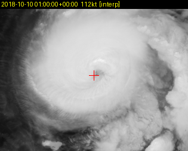
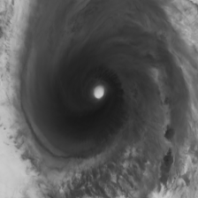

# Estimating hurricane intensity from GOES infrared imagery

Ten convolutional networks, averaged, estimate a tropical cyclone's maximum
sustained wind from a single infrared satellite frame. Labels come from
NOAA's HURDAT2 best track. The networks were trained on 2,081
storm-centered crops from 19 Atlantic storms between 2018 and 2024, after
removing frames with missing data.

The ensemble was frozen, then run once on the six Atlantic storms of 2025,
which nothing in the work had touched: 1,045 frames, all from GOES-19, a
newer satellite than any training frame. Its mean absolute error is
**9.78 kt**, against **12.13 kt** for the original single model on the same
frames. It still guesses low on the strongest storms, by about 16 kt at
category 5.

The write-up, with an hour-by-hour scrubber through Hurricane Ian, is at
<https://hurricane.johnazer.com>.

<p align="center">



</p>

Hurricane Michael over roughly three days in October 2018, from a
disorganized tropical storm to a category 5 at landfall. Every frame is
centered on the best-track position and shown exactly as the network
receives it, so cold cloud tops are dark. The middle label is interpolated
between six-hourly fixes; the outer two are true fixes.

## Building the dataset

HURDAT2 gives a storm's position and intensity every six hours as text.
GOES gives a full-disk image every few minutes as NetCDF. Most of the
work is matching them.

Samples fall between best-track fixes, so center position and wind speed
are linearly interpolated, and every sample carries a flag saying whether
it came from a real fix or an interpolation. Scoring against interpolated
labels is partly scoring against the interpolation, so results are also
reported on fixes only.

For each sample time the pipeline takes the nearest full-disk ABI band 13
scan within 10 minutes and records the offset. Anything with no scan in
range is skipped and logged, not substituted.

ABI data sits on a fixed angular grid in geostationary projection, so
cutting a 600 km box around a latitude and longitude means transforming
into the satellite's scan-angle coordinates first, using the projection
parameters stored in each file. Ground distance per pixel changes with
viewing angle, so crops are not a fixed pixel size; they are resized to
224 by 224 when loaded.

Frames with missing data (NaN pixels) are found by `check_nan.py`, which
scans every crop rather than filtering on the hour, and are listed in
`excluded_crops.txt`.

## The model

ResNet-18 with ImageNet weights and a single regression output. Brightness
temperature is clamped to 180–320 K, scaled to 0–1 and copied across three
channels; wind labels are divided by a fixed 185 kt. Each network is trained
with L1 loss, Adam at 1e-4 and batch size 32, for 25 epochs, keeping the
checkpoint with the lowest validation error.

The reported model trains this ten times with different seeds and averages
the ten predictions with equal weight. The ten checkpoints are frozen by
hash in `results/ensemble/members_sha256.txt`.

## Splitting and testing

Splits are by storm, never by frame. Hourly frames of the same storm are
near-duplicates, so a random split would put one hour of a storm in
training and the next in test, and the leak would look like success.

| Set | Storms | Frames | Role | List |
|---|---|---|---|---|
| Training | 19 | 2,081 | fitting | `storms_train_expanded.txt` minus the validation storms |
| Validation | 5 | 940 | checkpoint selection | `storms_val_expanded.txt` |
| Held-out development (H9) | 9 | 1,752 | comparing experiments | `storms_holdout_h9.txt` |
| 2025 test | 6 | 1,045 | one final run | `storms_test_2025.txt` |

The nine held-out development storms (H9) were never trained on, but they
were used to compare experiments and choose the training setup. They are
not a test: the ensemble's 8.57 kt there is optimistic.

The 2025 storms are the test. The ensemble's checkpoints and the evaluation
scripts were frozen and checked by hash before the run, and it was run
once.

## Results on 2025

| Category | Frames | MAE (kt) | Bias (kt) | Original model MAE |
|---|---|---|---|---|
| Depression | 22 | 7.59 | +7.59 | 8.28 |
| Storm | 456 | 8.58 | +3.62 | 10.84 |
| Category 1 | 166 | 9.42 | −6.29 | 10.01 |
| Category 2 | 129 | 8.78 | −6.42 | 13.28 |
| Category 3 | 84 | 15.29 | −7.90 | 17.84 |
| Category 4 | 137 | 9.85 | −6.25 | 12.69 |
| Category 5 | 51 | 15.81 | −15.75 | 18.43 |

Bias is the mean signed error, so a negative figure means the ensemble
guessed low. The ensemble is better than or equal to the original single
model in every category.

Where it fails:

- **The strongest storms.** It underestimates category 5 by about 16 kt on
  2025 and 19 kt on H9; averaging ten networks cannot remove a bias they
  share. Melissa peaked at 165 kt, above anything in training (160), and
  her eight frames above 160 kt got 133 to 143.
- **Weak systems** read high, by about 8 kt for depressions and 4 kt for
  tropical storms.
- **A new satellite or new storms?** Error on 2025 is 1.2 kt higher than on
  H9. Every 2025 frame is from GOES-19 and every training frame from
  GOES-16, so the test can't separate the instrument from the storms.

## Phase 2 in brief

The full account is on the site:
<https://hurricane.johnazer.com/#phase2>.

- **The old 9.00 kt headline was a lucky run.** Rerunning that recipe 33
  times gave a mean of 10.05 kt on the same held-out storms, and only one
  rerun in 33 did as well. Since then every result is an ensemble or a
  comparison across many seeds.
- **More distinct storms helped.** Training on 19 storms instead of 9
  lowered error on H9 by 1.6 kt and cut the high-end underestimate by
  5.4 kt, passing all three tests set in advance. The larger set also had
  more frames, so "more storms" and "more data" can't be fully separated.
- **More storms again made no difference.** From 19 storms to 50 at the
  same training budget: 0.53 kt worse, not significant, and the runs were
  flagged as under-trained, so the reading is "not at this budget".
- **Longer training helps.** Training four times longer lowered error on
  H9 by about one knot (0.99) across 20 paired seeds. A new ten-network
  ensemble trained that way is frozen and waits for its own one-time test
  on the 2026–2027 storms.
- **East Pacific, in progress.** Work is under way on adding East Pacific
  storms to training. A separate East Pacific test set stays sealed under
  a protocol fixed in advance.

Each phase-2 experiment's design, analysis script and pass thresholds were
committed before any training run, and the outcome is reported as the
script prints it. A separate AI review session, instructed to break each
design, recomputes the results before they are accepted.

## Reproducing

Requires Python 3.12 or later (`check_nan.py` uses
`pathlib.Path.is_junction`).

```
python -m venv .venv
.venv\Scripts\python.exe -m pip install -r requirements-dev.txt -e .
```

PyTorch, torchvision and matplotlib are not pinned in `requirements.txt`;
install them for your platform.

Data is not committed. `scripts/build_batch.py --ids-file <list>` rebuilds
crops from public NOAA sources for the storms in a list; the header of each
`storms_*.txt` file says how it was built (the ten storms added in phase 2
use 3-hourly sampling).

`scripts/check.py` runs the repository's invariant checks:

```
.venv\Scripts\python.exe scripts\check.py          # FAST: under 3 minutes, no network
.venv\Scripts\python.exe scripts\check.py --full   # every test and the smoke run
```

Where things live:

```
src/hurricane_intensity/   pipeline and dataset class
scripts/                   build, train, evaluate, analyses, site export
logs/decisions.md          running log of every decision and why
results/                   committed predictions and findings per experiment
                           (results/final_2025/findings.md is the 2025 test)
reports/                   designs, reviews and decision records
site/                      the published page
```

Where each number in this README comes from is listed in
`reports/site_v2/sources.md`.
